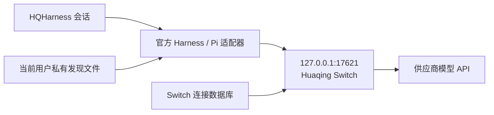

# Huaqing Switch 与 HQHarness 接入

2026-10-22。当前实现记录；覆盖先前文档中“仅配置管理、转发待接入”的状态。

## 产品与使用

产品显示名称统一为 **Huaqing Switch**。项目目录仍为 Huaqing Model Connection，已有应用 ID、包名、深链及数据库路径保持稳定，避免更名产生两份配置。品牌样式继续使用用户提供的 shadcn-ui-unify 规范。只显示 HQ Harness 和设置；其他客户端、路由、聚合及辅助管理入口不加载。

1. 启动 Switch，确认“本机服务”显示正在运行；默认监听 `127.0.0.1:17621`。
2. 添加连接，选择与供应商实际 API 相符的协议、地址、模型和密钥，设为默认。上下文/输出限制是本地预算，需要按供应商能力填写；图片支持必须显式开启。
3. 启动 HQHarness，新建会话即可使用。模型设置和原来的客户端密钥配置页面不加载。默认连接变化在最多约 5 秒内同步，作用于新会话。

Switch 未启动时，HQHarness 的默认来源仍是 Huaqing Switch，不会退回 DeepSeek 或其他直连。初次没有默认连接时显示 `huaqing-switch/awaiting-connection`；在 Switch 配置默认连接后新建会话。旧的直连会话请求会明确报错，需新建会话。

## 调用路径



主目录下 `.huaqing-switch/connector.json` 包含协议版本、产品标识、固定回环地址及每次 Switch 启动更新的随机本地凭证。HQHarness 读取此文件并请求带鉴权的 `/hq/manifest`。供应商密钥留在 Switch 的独立 SQLite 配置中，不进入 Harness 或渲染器。

模型目录返回名称、协议、连接版本及本地预算。Harness 注册单一 `huaqing-switch` provider，继续使用官方 Pi 的 Chat Completions、Responses、Anthropic Messages 适配器；Switch 保持供应商原生报文，改写模型和鉴权后流式透传。没有自制协议转换、自动降级或失败重放。当前客户端成本值为未配置的零值，不能作为实际账单。

每个模型使用 `hq-<连接 UUID>-v<版本>`，路径包含同一连接和版本：

- `/hq/connections/:id/:revision/v1/chat/completions`
- `/hq/connections/:id/:revision/v1/responses`
- `/hq/connections/:id/:revision/v1/messages`

改变默认项不会重定向已有会话。编辑连接会增加版本；旧会话不能悄悄使用新配置，返回版本失效错误并要求新建会话。删除连接同理。重启 Switch 后，本地凭证更新；后续模型调用会重新读取凭证。

## 运行约束

- 仅监听 IPv4 回环；校验固定 Host、本地访问凭证，拒绝 Origin 请求，不提供浏览器 CORS 接口。供应商重定向不会自动跟随。
- Unix 下目录/发现文件分别为 0700/0600；客户端拒绝符号链接、其他用户拥有或组/其他人可读的文件。Windows 使用当前用户主目录及系统文件权限；没有宣称使用系统钥匙串或应用层加密。
- 单次请求体最多 25 MiB，并发最多 16；连接 10 秒、响应头 60 秒、上传读取 30 秒、流空闲 120 秒、整体流 300 秒。超额直接失败，不自动重复扣费请求。
- 请求取消会关闭上游流。日志只记录请求 ID、状态和耗时，不记录密钥、提示词或模型正文。客户端与 UI 不返回已保存的供应商密钥。
- 端口占用时停止接入并在 Switch 页面显示错误；释放端口后点击重试。不会寻找其他端口或信任占用同端口的陌生服务。
- HQHarness 保留原有随机运行时端口；固定端口只属于 Switch。没有修改系统代理、Claude Code 或 Codex 的配置。
- 本地文件凭证用于隔离浏览器和其他用户，不用于抵抗同一操作系统账户下的恶意进程。

## 代码位置与可复现验证

Switch：`src-tauri/src/hq.rs`、`src-tauri/src/hq/gateway.rs`、`src/components/hq/HqApp.tsx`、`src/lib/api/hq.ts`。

HQHarness：`src/main/huaqing-switch.ts`、主进程运行时环境、preload 来源标识，以及现有 `packages/hqharness-model-access` 中的 Switch 插件。两个针对锁定上游版本的 patch-package 补丁分别限制 LLM 供应商和禁止模型设置模块挂载；保留了这些补丁中先前已有的客户端改动。没有引入第二套运行时或 UI。

```sh
# Switch 仓库；启动实际原生应用和实际 Harness/Pi runtime，用本地确定性 API 测试
node scripts/verify-harness-connector.mjs /path/to/HQHarness

# HQHarness 仓库
node node_modules/typescript/bin/tsc --noEmit -p tsconfig.node.json
node node_modules/vitest/vitest.mjs run test/huaqing-switch.test.mjs test/huaqing-switch-env.test.ts test/model-access-harness.test.ts test/desktop-onboarding.test.ts test/focused-client-runtime.test.ts test/model-settings-render.test.mjs
npm run build
```

实际检查包括：三协议流式工具调用、密钥注入及模型改写、无鉴权/浏览器来源拒绝、输出上限、重定向不泄露凭证、取消传播、重启凭证轮换、默认切换后原会话保持原连接、编辑后拒绝过期版本、旧供应商拦截。原生联调结果留存在本地 `validation/huaqing-harness-e2e.json`；验证目录不随源码提交。

已完成 Switch 原生存储测试、相关前端检查、HQHarness 类型检查和 6 个文件共 35 项相关测试；从不含 node_modules/生成目录的源码副本执行完整 `npm ci` 和 postinstall 补丁重放成功。两端 macOS arm64 未签名验证包构建成功。真实付费供应商调用、Windows/Linux 原生安装启动、正式签名/公证和发行服务仍需对应环境验收，不能把本轮本地协议测试等同于这些验证。

## 构建产物与验收记录

- Switch 验证包：`release/macos/Huaqing Switch.app`。
- HQHarness 验证包：HQHarness 仓库下的 `dist/mac-arm64/HQHarness.app`。

最终验收补充：干净安装副本在标准完整构建后同样通过 6 个文件、35 项测试；Office 依赖只复用 SHA 校验的下载缓存，运行时资源重新生成。最终 Electron 界面与 ASAR 核对记录分别留存在本地 `validation/huaqing-harness-native-ui.json`、`validation/huaqing-harness-package-audit.json`。测试应用及本机端口已退出。本机磁盘和缓存清理明细仅保留在本地验证资料中。
