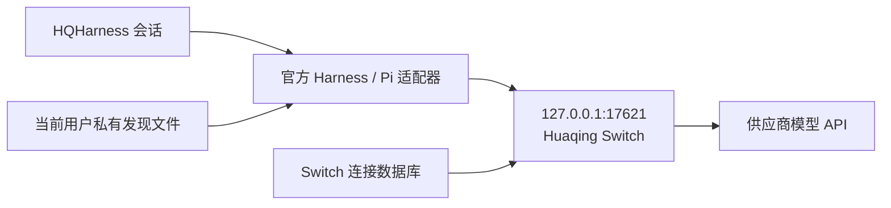

# Huaqing Switch 与 HQHarness 接入

2026-10-27 更新。记录当前实现、可复现验证方式及 Windows 106 服务器的验收范围。

## 产品与使用

产品显示名称统一为 **Huaqing Switch**，源码仓库为 `huaqing-switch`。已有应用 ID、包名、深链及数据库路径保持稳定，避免更名产生两份配置。品牌样式继续使用用户提供的 shadcn-ui-unify 规范。0.1.1 起显示 HQ Harness、用量统计和设置；其他客户端、路由、聚合及辅助管理入口不加载。

1. 启动 Switch，确认“本机服务”显示正在运行；默认监听 `127.0.0.1:17621`。
2. 添加连接，选择与供应商实际 API 相符的协议、地址、模型和密钥，设为默认。上下文/输出限制的单位为 Token，填写完整整数，例如十进制 1M 上下文填 `1000000`，393k 输出填 `393000`；服务商有精确值时以精确值为准。这是本地预算，需要按供应商能力填写；图片支持必须显式开启。详见[限制与用量说明](hq-usage.md)。
3. 启动 HQHarness，新建会话即可使用。模型设置和原来的客户端密钥配置页面不加载。默认连接变化在最多约 5 秒内同步，作用于新会话。

Switch 未启动时，HQHarness 的默认来源仍是 Huaqing Switch，不会退回 DeepSeek 或其他直连。初次没有默认连接时显示 `huaqing-switch/awaiting-connection`；在 Switch 配置默认连接后新建会话。旧的直连会话请求会明确报错，需新建会话。

## 调用路径



主目录下 `.huaqing-switch/connector.json` 包含协议版本、产品标识、固定回环地址及每次 Switch 启动更新的随机本地凭证。HQHarness 读取此文件并请求带鉴权的 `/hq/manifest`。供应商密钥留在 Switch 的独立 SQLite 配置中，不进入 Harness 或渲染器。

模型目录返回名称、协议、连接版本及本地预算。Harness 注册单一 `huaqing-switch` provider，继续使用官方 Pi 的 Chat Completions、Responses、Anthropic Messages 适配器；Switch 保持供应商原生报文，改写模型和鉴权后流式透传。没有自制协议转换、自动降级或失败重放。当前客户端成本值为未配置的零值，不能作为实际账单。

每个模型使用 `hq-<连接 UUID>-v<版本>`，路径包含同一连接和版本：

- `/hq/connections/:id/:revision/v1/chat/completions`
- `/hq/connections/:id/:revision/v1/responses`
- `/hq/connections/:id/:revision/v1/messages`

改变默认项不会重定向已有会话。编辑连接会增加版本；旧会话不能悄悄使用新配置，返回版本失效错误并要求新建会话。删除连接同理。重启 Switch 后，本地凭证更新；后续模型调用会重新读取凭证。

## 运行约束

- 仅监听 IPv4 回环；校验固定 Host、本地访问凭证，拒绝 Origin 请求，不提供浏览器 CORS 接口。供应商重定向不会自动跟随。
- Unix 下目录/发现文件分别为 0700/0600；客户端拒绝符号链接、其他用户拥有或组/其他人可读的文件。Windows 使用当前用户主目录及系统文件权限；没有宣称使用系统钥匙串或应用层加密。
- 单次请求体最多 25 MiB，并发最多 16；连接 10 秒、响应头 60 秒、上传读取 30 秒、流空闲 120 秒、整体流 300 秒。超额直接失败，不自动重复扣费请求。
- 请求取消会关闭上游流。日志只记录请求 ID、状态和耗时，不记录密钥、提示词或模型正文。客户端与 UI 不返回已保存的供应商密钥。
- 端口占用时停止接入并在 Switch 页面显示错误；释放端口后点击重试。不会寻找其他端口或信任占用同端口的陌生服务。
- HQHarness 保留原有随机运行时端口；固定端口只属于 Switch。没有修改系统代理、Claude Code 或 Codex 的配置。
- 本地文件凭证用于隔离浏览器和其他用户，不用于抵抗同一操作系统账户下的恶意进程。
- 原生验收通过 `CC_SWITCH_TEST_HOME` 将数据库、发现文件和日志写入临时目录；它优先于已保存的自定义数据目录。验收前须退出正在运行的 Switch，固定端口和单实例标识不会随测试目录改变。

## 代码位置与可复现验证

Switch：`src-tauri/src/hq.rs`、`src-tauri/src/hq/gateway.rs`、`src-tauri/src/hq/usage.rs`、`src/components/hq/HqApp.tsx`、`src/components/hq/HqUsagePage.tsx`、`src/lib/api/hq.ts`。0.1.1 的限制单位与独立 HQ 用量统计、数据口径和本地验证见[专门说明](hq-usage.md)。下方 0.1.0 / HQHarness 0.1.8 记录仍对应此前实际安装验收的安装包。

HQHarness：`src/main/huaqing-switch.ts`、主进程运行时环境、preload 来源标识，以及现有 `packages/hqharness-model-access` 中的 Switch 插件。两个针对锁定上游版本的 patch-package 补丁分别限制 LLM 供应商和禁止模型设置模块挂载；保留了这些补丁中先前已有的客户端改动。没有引入第二套运行时或 UI。

```sh
# Switch 仓库；启动实际原生应用和实际 Harness/Pi runtime，用本地确定性 API 测试
node scripts/verify-harness-connector.mjs /path/to/HQHarness

# Windows PowerShell；验证源码开发环境与原生可执行文件
node scripts/verify-harness-connector.mjs C:\src\HQHarness --binary C:\src\huaqing-switch\src-tauri\target\debug\hq-model-switch.exe

# 自定义构建目录或安装包时，显式指定二进制和证据输出目录
node scripts/verify-harness-connector.mjs /path/to/HQHarness --binary /path/to/hq-model-switch --output-dir /path/to/validation --timeout-ms 120000

# 脚本自身回归；无需构建原生应用或调用付费模型
node --test scripts/verify-harness-connector.test.mjs scripts/windows-installer.test.mjs scripts/windows-resources.test.mjs

# HQHarness 仓库
node node_modules/typescript/bin/tsc --noEmit -p tsconfig.node.json
node node_modules/vitest/vitest.mjs run test/huaqing-switch.test.mjs test/huaqing-switch-env.test.ts test/model-access-harness.test.ts test/desktop-onboarding.test.ts test/focused-client-runtime.test.ts test/model-settings-render.test.mjs
npm run build
```

联调脚本要求 Node.js 24 或更高版本，与 HQHarness 开发要求一致；直接使用 Node 内置 SQLite，不需要 Python 或外部 sqlite3。默认二进制为当前平台的 Tauri debug 产物：Windows/Linux 使用 `src-tauri/target/debug/hq-model-switch[.exe]`，macOS 使用该目录中 bundle 内的可执行文件。使用 release、自定义 `CARGO_TARGET_DIR` 或已安装应用时传入 `--binary`。源码模式的 HQHarness 路径须包含已安装依赖、现有 Switch 插件和 `build/harness-node-entry.mjs`。路径含空格时使用 shell 对应的引号。

已安装 HQHarness 使用 `--harness-exe` 与 `--harness-app-root`，后者必须指向同一安装目录中的 `resources/app.asar`。脚本由该 EXE 的 Electron Node 模式加载 ASAR 内的真实 Harness/Pi 依赖及 Switch 插件，并记录实际 EXE/ASAR 路径，以及 Desktop、Electron 和 Node 版本；无需在目标服务器检出 HQHarness 源码或安装 npm 依赖。两种 HQHarness 输入模式不能混用。

以下命令在 Switch 仓库内运行，使用生产应用的准确 HKCU 卸载键定位 HQHarness 0.1.8，不遍历磁盘或读取用户配置。执行前须通过托盘“退出”正常关闭 Switch，避免固定端口和单实例冲突。

```powershell
$registration = Get-ItemProperty -LiteralPath 'HKCU:\Software\Microsoft\Windows\CurrentVersion\Uninstall\0efcdb0c-0869-57ce-862f-b5dcc16b1997'
if ($registration.DisplayName -cne 'HQHarness 0.1.8' -or $registration.DisplayVersion -cne '0.1.8') {
  throw 'Expected the production HQHarness 0.1.8 installation'
}
if ($registration.UninstallString -notmatch '^\s*"([^"]+\\Uninstall HQHarness\.exe)"(?:\s|$)') {
  throw 'Unexpected HQHarness uninstall registration'
}
$harnessExe = Join-Path (Split-Path -Parent $Matches[1]) 'HQHarness.exe'
$harnessAsar = Join-Path (Split-Path -Parent $harnessExe) 'resources\app.asar'
$switchExe = Join-Path $env:LOCALAPPDATA 'Programs\Huaqing Switch\hq-model-switch.exe'
node scripts/verify-harness-connector.mjs --harness-exe "$harnessExe" --harness-app-root "$harnessAsar" --binary "$switchExe" --output-dir .\validation\installed-acceptance --timeout-ms 180000
```

每次启动前检查固定端口 17621，已有服务占用时直接停止验收，不终止或改写用户的 Switch。验收使用独立临时 home、数据库及 Harness Profile；所有上游连接均指向本次创建的回环 fixture。输出目录自动创建，开始新验收时移除该目录里旧的成功报告，日志和成功 JSON 保存在临时 home 之外。脚本发出的控制探测每次最多 5 秒，整个验收默认最多 120 秒，可用 `--timeout-ms` 设置 1000–600000 毫秒；超时、中断和失败均关闭本次子进程及监听器，确认退出后再删除临时数据。无法确认子进程退出时保留临时文件并报错。脚本回归覆盖路径解析、端口占用保护、SQLite 更新、提前退出、强制终止、整体验收超时及旧报告失效；跨平台路径测试不替代对应系统的原生联调。

实际检查包括：三协议流式工具调用、密钥注入及模型改写、无鉴权/浏览器来源拒绝、输出上限、重定向不泄露凭证、取消传播、重启凭证轮换、默认切换后原会话保持原连接、编辑后拒绝过期版本、旧供应商拦截。原生联调结果保存在指定输出目录的 `huaqing-harness-e2e.json`；默认位置为本地 `validation/huaqing-harness-e2e.json`。验证目录不随源码提交。

此前已完成 Switch 原生存储测试、相关前端检查、HQHarness 类型检查和 6 个文件共 35 项相关测试；从不含 node_modules/生成目录的源码副本执行完整 `npm ci` 和 postinstall 补丁重放成功。两端 macOS arm64 未签名验证包构建成功。Windows 原生安装、已安装依赖联调及本轮 CI 结果见下；Linux 原生安装启动、真实付费供应商调用和正式签名发行仍待对应环境验收。

## 构建产物与验收记录

### Windows 安装验收包

`.github/workflows/windows-acceptance.yml` 在 Windows 原生 runner 上从 `dev` 构建 MSI。首次提交该工作流会触发构建，后续可在 Actions 中手动执行。它使用固定的 Node、pnpm 和 Rust 版本及锁文件，先执行 Windows 验收脚本回归，再通过标准 Tauri release 构建生成当前用户安装包；产物同时包含 SHA256、源码提交和未签名状态，不创建正式 Release。

下载 Actions 产物后先核对 `SHA256SUMS.txt` 与 `package.json` 中的源码提交。安装可以使用 `msiexec /i <完整 MSI 路径> /qn /norestart CREATEDESKTOPSHORTCUT=0`；安装后仍须在目标 Windows 上核对版本、启动界面、本机服务和实际 HQHarness/Pi 调用。构建成功、安装成功与模型请求成功分别记录。未签名验收包不能作为正式签名发行包。

### 0.1.1 用量统计升级（2026-10-27）

产品提交 `382dba631dc5ff2f9b8d1f04bde1ec8e417d4e32` 的 [主 CI 40439609050](https://github.com/hqzyai/huaqing-switch/actions/runs/40439609050) 全部通过，[Windows 打包 40439610412](https://github.com/hqzyai/huaqing-switch/actions/runs/40439610412) 成功。Windows x64 MSI 已经由 Mac 下载、核验、传至 106，并以退出码 0 从 0.1.0 升级到 0.1.1。MSI SHA256 为 `d9e92360597ad66bde81ca8068631932144a4b9b2d2abb1d4fb9ec9d04edb6b5`，安装后的 EXE SHA256 为 `5c32efb80503a9d0bf04a52855f0e9d697d63d22766df9c52b6161e22a5cf225`；安装身份、版本、资源及当前用户安装范围均已核对。

已安装 EXE 的独立原生验收完成 9 次本地 fixture 请求、11 项检查。真实客户端用量页显示 9 次成功请求、输入 120、输出 55、总计 175、缓存读取 44、缓存写入 13 Token，缺失用量 1 次、完整用量 8 次，和持久化记录一致。重启保留、删除连接保留历史、鉴权拒绝不污染统计、响应字节保持不变均通过。详细统计口径见[限制与用量说明](hq-usage.md)。

验收使用独立数据库，没有调用付费模型；生产连接配置保持不变。临时原生进程、数据库和传输服务均已清理，原有 Switch / HQHarness 已恢复运行，默认连接与模型清单已核对。HQHarness 0.1.8 沿用此前安装包，本次没有重新执行完整对话和 browser 验收。

本地证据为 `validation/hq-usage/transfer/usage-installed.json`、`usage-native.json`、`usage-preflight.json` 及 `validation/hq-usage/gui-evidence.json`。实际验收安装包及脱敏报告已发布到 [Switch 0.1.1 预发布版](https://github.com/hqzyai/huaqing-switch/releases/tag/v0.1.1-acceptance.20261027)，版本标签固定到上述产品提交；后续文档提交不改变打包来源。

### 此前 0.1.0 / HQHarness 0.1.8 的构建来源

此前使用的 Windows 包与代码来源：

| 项目                       | 来源与验收状态                                                                                                                                                                                                                                  |
| -------------------------- | ----------------------------------------------------------------------------------------------------------------------------------------------------------------------------------------------------------------------------------------------- |
| Switch 已验收产品代码      | `6eed6592406fdf2f8271c8bda685f5e53c783748`；[主 CI 40302472033](https://github.com/hqzyai/huaqing-switch/actions/runs/40302472033) 的前端、Linux/Windows/macOS 后端及 WSL2 检查通过。后续 `0af7273` 仅更新验收文档。                            |
| Switch 0.1.0 MSI           | 源码 `136609ac3d3a4d6b64af18b283864a4f46a6973d`；[Windows 打包 40292921395](https://github.com/hqzyai/huaqing-switch/actions/runs/40292921395) 成功。到上述产品代码仅增加联调验证脚本及 golden 测试修正，产品源码、依赖、资源和安装器配置相同。 |
| HQHarness 当前代码         | `61788d465e95d8480fc16a59727e955461c487f7`；[Windows 完整验收 CI 40315304291](https://github.com/jiawenyao401/HQHarness/actions/runs/40315304291) 的构建、测试、原生验证和草稿交付核验通过。                                                    |
| 106 已安装 HQHarness 0.1.8 | 源码 `c26c526b491006db8bbb462011c44ed31aac95e4`；生产应用 ID 为 `app.hqharness.desktop`。到 `61788d4` 只改草稿交付脚本与对应测试，产品输入树相同。                                                                                              |

已安装 Switch MSI 的 SHA256 为 `3b063a29476e4233673114db8453c9dcf84389ab47e1e52eb6e2a1d9d87e3ce9`；已安装 HQHarness NSIS 包的 SHA256 为 `8f564537c63d21993d4fcd00d239593e168f1d02478db7393823ffc91c63b9a8`。两者均在传输后校验并以退出码 0 安装。HQHarness 构建流程先交付草稿，上传后通过真实 release ID 检查源码、草稿标记及资产，避免未发布 tag 的 REST 404 造成误报。2026-10-27 应用户要求，已将两份实际验收的安装包发布为预发布版：[Switch 0.1.0](https://github.com/hqzyai/huaqing-switch/releases/tag/v0.1.0-acceptance.20261027)、[HQHarness 0.1.8](https://github.com/jiawenyao401/HQHarness/releases/tag/v0.1.8-acceptance.20261027)。均附 SHA256 和脱敏验收报告；HQHarness 仓库权限保持私有。

### 此前 106 的 0.1.0 / HQHarness 0.1.8 验收

- **Switch 正常启动和表单**：已安装 EXE 显示 0.1.0，本机服务监听回环 17621；连接编辑器可滚动到底部字段，保存按钮始终可见，托盘正常退出通过。证据为本地 `validation/windows-transfer/switch-installed-acceptance.json` 与 `switch-form-106.png`。浏览器尺寸回归另覆盖 1000×640、1100×650、1920×1080，包含键盘到达保存按钮。
- **MSI 卸载及重装**：卸载和重装均退出 0。共享 Programs 目录中的任务专用哨兵文件内容保持不变，重装后 EXE 哈希与首次安装一致。证据为本地 `validation/windows-transfer/switch-uninstall-acceptance.json`；该回归验证此前危险的共享父目录通配删除规则已移除。
- **HQHarness 安装后身份**：NSIS 安装退出 0，已安装 EXE 为 0.1.8.0，ASAR 内包版本为 0.1.8；按精确生产注册表键及 `HQHarness 0.1.8` / `0.1.8` 的注册名和版本核验，Switch 插件与主进程来源策略存在。安装后的独立核验读取固定 ASAR 文件，不运行桌面主入口或打开用户配置。证据为本地 `validation/windows-transfer/harness-qualified.json`。
- **已安装 EXE + ASAR 核心联调**：使用 Windows x64 Node 24.10.0 驱动已安装 Switch，与 HQHarness 自带 Electron 44.7.0 / Node 24.21.0 的实际 ASAR 依赖联调。三协议流式工具调用、鉴权与重定向保护、取消、凭证轮换、默认切换保留旧连接、旧版本拒绝、旧供应商拦截、离线及重启均通过，验证器退出 0，未遗留本轮子进程。证据为本地 `validation/windows-transfer/installed-acceptance.json`。
- **已安装应用的新对话**：从桌面正常启动 HQHarness，原有会话保留，新建会话自动选择 Switch 默认连接；经实际对话输入和发送，回复正文出现 `CHAT_PASS`。操作截图为本地 `validation/windows-transfer/gui-chat-106.png`。
- **当前会话的 browser 工具往返**：在同一会话接受原生浏览器授权后，工具驱动真实本机浏览器访问本轮拥有的测试页，页面收到 1 次 GET；工具返回在同一调用 ID 下包含当前运行生成的随机无障碍树标记，随后对话正文出现 `BROWSER_PASS`。操作截图为本地 `validation/windows-transfer/gui-browser-page-106.png` 与 `gui-browser-result-106.png`。
- **本轮结束操作**：通过 Switch 界面删除临时连接，连接列表恢复为空；通过 HQHarness“应用 > 退出”正常关闭客户端及其独立浏览器，再从托盘正常退出 Switch，屏幕键盘已关闭。本轮 GUI fixture 已停止，报告中 `stopped=true`。最终实机只读检查确认 17621/18766 端口已释放、HQHarness 与 Switch 进程已退出、fixture 状态文件不存在，两端已安装 EXE 和生产注册信息保留，版本仍为 0.1.0 / 0.1.8.0；本地 `validation/windows-transfer/cleanup-acceptance.json` 中 `passed=true`。

本轮 GUI 结果记录在本地 `validation/windows-transfer/gui-acceptance.json`：`passed=true`，带鉴权模型请求、文本往返、browser 工具提供、页面访问、无障碍观察核验和最终回复共 6 项均通过；记录 5 次模型请求，鉴权拒绝、模型拒绝、无效请求及工具失败计数均为 0。该报告与上述三张操作截图共同支持已安装应用的新对话和 browser 路径验收。

协议回归和 GUI 联调均使用确定性本地 API fixture；`paidModelCall=false`，安装后的产品包未修改，两个验收包仍未签名。本轮未执行 computer 工具的 106 GUI 操作，也不据此认定真实供应商调用、正式签名/公证、公开发行服务或实际课堂性能已通过。

### 此前的 macOS 验证包

- Switch 验证包：`release/macos/Huaqing Switch.app`。
- HQHarness 验证包：HQHarness 仓库下的 `dist/mac-arm64/HQHarness.app`。

macOS 阶段的干净安装副本在标准完整构建后同样通过 6 个文件、35 项测试；Office 依赖只复用 SHA 校验的下载缓存，运行时资源重新生成。该阶段的 Electron 界面与 ASAR 核对记录分别留存在本地 `validation/huaqing-harness-native-ui.json`、`validation/huaqing-harness-package-audit.json`，相应测试应用及端口已退出。本机磁盘和缓存清理明细仅保留在本地验证资料中。
